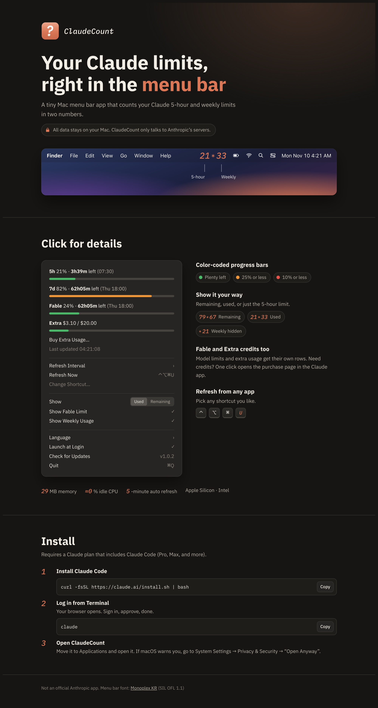

# ClaudeCount

Count your Claude limits — the 5-hour and weekly usage, right in your Mac menu bar.

**[Website](https://hellocket.github.io/ClaudeCount/)** · [한국어](https://hellocket.github.io/ClaudeCount/ko/) · [Download](https://github.com/hellocket/ClaudeCount/releases/latest)

[](https://hellocket.github.io/ClaudeCount/)

```
21 ✻ 33      left = 5-hour limit, right = weekly limit
```

---

## ⚠️ Before you start

- **Requires a Claude Code login.** ClaudeCount reads the login that Claude Code saves in your Mac's keychain.
- **All data stays on your Mac.** The app only talks to Anthropic's servers (to fetch usage and refresh the login), plus GitHub when you click **Check for Updates**. Nothing is sent to analytics, ads, or any third party. It stores: settings, a status log (`~/Library/Logs/ClaudeCount.log`), the last usage numbers (`~/Library/Caches/ClaudeCount`), the sign-in helper script (`~/Library/Application Support/ClaudeCount`), and the launch-at-login item. Login tokens are never written to any file.
- **It refreshes your login.** When the saved login expires, ClaudeCount refreshes it the same way Claude Code does and saves it back to the keychain. If Claude Code ever gets logged out, run `claude` in Terminal and log in again.
- **Not an official app.** It uses the usage API that Claude Code uses internally. If Anthropic changes that API, the app may stop working.
- **Not notarized by Apple.** macOS warns you the first time you open it. Follow step 3 below.
- **Don't relaunch it over and over.** Too many requests in a short time get rate-limited (HTTP 429) and the numbers show `–`. They come back on their own after a few minutes.

---

## Requirements

- macOS 13 or later (Apple Silicon and Intel)
- A Claude plan that includes Claude Code, such as **Pro, Max, Team, or Enterprise** (the free plan doesn't include Claude Code)
- **Claude Code installed and logged in from Terminal** (steps 1–2 below)

## Install

### 1. Install Claude Code

Open the `Terminal` app (search "Terminal" in Spotlight), paste this, and press Enter.

```bash
curl -fsSL https://claude.ai/install.sh | bash
```

- The installer shows no progress while it downloads. Wait until it finishes.
- Then **close Terminal, open a new window**, and check the install. A version number means it worked.

```bash
claude --version
```

- With Homebrew you can also run `brew install --cask claude-code`.
- Skip this step if Claude Code is already installed.

### 2. Log in to Claude from Terminal

Run this in Terminal.

```bash
claude
```

1. On first run it asks how to log in. Choose **your Claude account (subscription)**.
2. Your browser opens. Sign in with your Claude account and click **Authorize**.
3. When Terminal says you're logged in, you're done. Type `/exit` or press `Ctrl + C` twice to quit Claude Code.

> Skip this step if you've logged in before. The login stays in your keychain.

### 3. Install ClaudeCount

**Homebrew**

```bash
brew install --cask hellocket/tap/claudecount
```

**Or download** `ClaudeCount.dmg` or `ClaudeCount.zip` from [Releases](https://github.com/hellocket/ClaudeCount/releases).

1. Put the app in your `Applications` folder.
   - **DMG**: open `ClaudeCount.dmg` and drag the ClaudeCount icon onto the `Applications` folder next to it.
   - **zip**: unzip `ClaudeCount.zip` and move `ClaudeCount.app` to `Applications`.
2. Double-click the app. If macOS says it can't be opened:
   - Go to **System Settings → Privacy & Security** and click **Open Anyway** at the bottom.
   - Or run this once in Terminal, then open the app again.
     ```bash
     xattr -dr com.apple.quarantine /Applications/ClaudeCount.app
     ```
3. If it asks for keychain access, click **Always Allow**.
4. Orange numbers in the menu bar mean you're set. To start it with your Mac, click the numbers and turn on **Launch at Login**.

---

## Using it

### Menu bar

- The left number is the **5-hour limit**, the right number is the **weekly limit**.
- It refreshes every 5 minutes by default (choose 1, 2, 5 or 10 minutes under **Refresh Interval**) and when your Mac wakes from sleep.

### Menu (click the numbers)

> The app follows your Mac's language (English or Korean). Switch it anytime under **Language**.

| Item | What it does |
|---|---|
| 5h / 7d | e.g. `5h 13% · 3h56m left (07:30)`: percent, time until reset, reset time. The bar goes green → orange (25% or less left) → red (10% or less left) |
| Fable, etc. | Model-specific weekly limits get their own row once you start using them (1% or more). Unused models appear when "Show … Limit" is on |
| Extra | Shown only when extra usage is turned on. With a limit: `Extra $3.10 / $20.00` and a bar. Balance only: `Extra $4.20 left` |
| Buy Extra Usage… | Opens the usage settings in the Claude desktop app, or claude.ai in your browser if the app isn't installed |
| Last updated | When the numbers were last fetched. Errors such as HTTP 429 appear here too |
| Refresh Interval › | Check every 1, 2, 5 or 10 minutes. If the server rate-limits (HTTP 429), ClaudeCount backs off on its own: 2 → 4 → 8 → 16 → up to 30 minutes |
| Refresh Now | Refreshes right away. Your shortcut is shown on the right |
| Change Shortcut… | Press any key combination to set a new shortcut |
| Show: Used / Remaining | A toggle: show how much you've used, or how much is left |
| Show (model) Limit | Appears only if your account has model-specific limits such as Fable. Shows them even at 0% |
| Show Weekly Usage | On: `21 ✻ 33`. Off: only the 5-hour number, `✻ 21` |
| Language › | Switch between English and 한국어 |
| Launch at Login | Starts ClaudeCount when you log in to your Mac |
| Check for Updates | Checks GitHub for a newer version. If there is one, click **Update Now**: ClaudeCount downloads it, replaces itself and reopens. Your settings are kept |
| Quit ⌘Q | Quits ClaudeCount |

### Shortcut

- The default is **⌃⌥⌘U**, and it works while you're in any app.
- Click **Change Shortcut…** and press the combination you want. It saves right away.
  - Include at least one of ⌃ ⌥ ⌘. F1–F20 work on their own.
  - If another app already uses that combination, you'll be asked to pick another.
  - `Esc` cancels. `Delete` turns the shortcut off.

## Troubleshooting

| Message in the menu | Fix |
|---|---|
| No Claude Code login | Install Claude Code and log in with `claude` in Terminal (steps 1–2) |
| Login expired | Run `claude` in Terminal once to log in again, then refresh |
| Server error (HTTP 429) | Too many requests. ClaudeCount waits and retries automatically; avoid pressing Refresh repeatedly |
| Network error | Check your internet connection |

The status log is at `~/Library/Logs/ClaudeCount.log`. It never contains tokens or other secrets.

## Lightweight

- About 29 MB of memory, close to 0% CPU while idle
- 3.9 MB app, mostly the bundled font

## Build it yourself

```bash
./build.sh
```

All you need is the Xcode Command Line Tools. The build installs to `~/Applications` and also creates `ClaudeCount.zip` and `ClaudeCount.dmg` for sharing.

## Font license

The menu bar numbers use the Text Italic style of [Monoplex KR Nerd](https://github.com/y-kim/monoplex). The font is released under the **SIL Open Font License 1.1** and is bundled unmodified. The full license is in `FONT-LICENSE (Monoplex OFL).txt` in the download and inside the app (`Contents/Resources/Fonts/Monoplex-LICENSE.md`).
